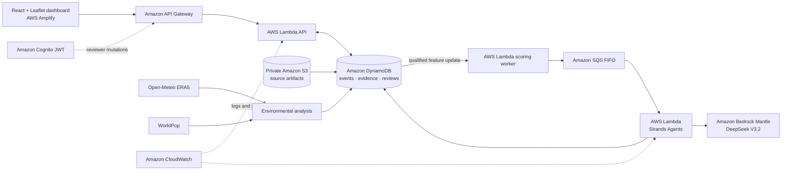

# BurnBlind

[](https://github.com/Vishwaksen0124/burnblind/actions/workflows/backend-deploy.yml)
[](https://github.com/Vishwaksen0124/burnblind/actions/workflows/amplify-deploy.yml)

**A satellite signal is only part of the story. BurnBlind helps environmental reviewers see what supports a potential fire event, what is uncertain, and what deserves a closer look.**

BurnBlind is a map-first environmental monitoring and investigation application focused on agricultural-fire observations in **Punjab and Haryana, India**. It joins satellite evidence with source-labelled weather and population context, presents uncertainty explicitly, and gives a human reviewer control over event investigation and review.

> **This is a historical replay and research prototype, not a live fire-alert service.** Satellite candidate events are not confirmed fires. Scores are not calibrated probabilities, and the Investigation Agent does not make emergency decisions.

## Try BurnBlind

- **[Open the dashboard](https://main.d3k8g1d6au7814.amplifyapp.com/)**
- **[Check the replay API](https://ad4m8eny2m.execute-api.us-east-2.amazonaws.com/prod/api/health)**
- **[Read the build journey](docs/BUILD_JOURNEY.md)**
- **[Browse the implementation history](https://github.com/Vishwaksen0124/burnblind/commits/main/)**

The public dashboard supports reading replay data. Investigation requests and review submissions require an authorized Cognito reviewer account; credentials are not included in the repository.

## What you can explore

- **Monitoring map:** browse 250 historical candidate events and open a candidate to inspect its source observations.
- **Environmental context:** inspect the nearest preceding ERA5 hourly estimate and WorldPop population estimates within a directional screening corridor.
- **Historical activity:** environmental enrichment derives same-grid, same-month GK2A detection counts from complete prior years, with source lineage and temporal cutoffs. These are historical detection records, not unique fires or confirmation.
- **Sensor comparison:** inspect four source-matched comparisons. They currently report agreement; agreement is not proof of a fire.
- **Investigation:** request an event-scoped, evidence-grounded report from the Strands agent. Environmental enrichment by itself does not launch an investigation for every event.
- **Human review:** inspect findings and uncertainty, then record an authorized reviewer outcome.
- **Methodology and limitations:** see how sources, estimates, review states, and unavailable inputs are represented.

### Production replay snapshot

Live API values checked on **October 11, 2026**:

| Layer | Available records | What the value means |
|---|---:|---|
| Candidate events | 250 | Historical GK2A-derived candidate clusters, not verified incidents |
| Weather estimates | 250 | Open-Meteo ERA5 reanalysis context, not local station readings |
| Population estimates | 250 | WorldPop modelled population within a screening corridor, not people known to be affected |
| Matched sensor comparisons | 4 | Source-matched observations; all currently report `AGREEMENT` |
| Bundled historical source index | 352,435 detections · 3,856 grids | Pinned GK2A archive (2019–2025, October–November); enrichment uses complete prior years only |
| Valid sensor-coverage / blind-spot scores | 0 | The replay has no valid, normalized coverage measurements, so a score is correctly unavailable |

The production data was audited and corrected across all 250 events. The audit explains the two invalid coverage artifacts, duplicate comparison pairs, and the fixes in [the data-quality report](docs/DATA_QUALITY_AUDIT_2026-10-10.md).

## How it works

```text
Historical satellite observations
              │
              ▼
      Candidate event map ───────────────► Reviewer selects an event
              │                                     │
              ▼                                     ▼
Source-backed environmental context       Explicit investigation request
  ERA5 weather · WorldPop corridor                   │
              │                                      ▼
              │                            Strands investigation agent
              │                                      │
              │                          DeepSeek V3.2 via Bedrock Mantle
              │                                      │
              └──────────────┬───────────────────────┘
                             ▼
            Evidence-cited report → Human review
```

Environmental calculations and application-owned scores are kept separate from the LLM. The agent receives an event-scoped evidence packet, uses read-only tools, and returns a structured report. It must distinguish observations from estimates, cite supplied evidence IDs, state missing information, and avoid declaring a fire confirmed. A reviewer remains responsible for the decision.

In the current replay, missing observability inputs stay unavailable. BurnBlind does not convert absent coverage into a zero blind-spot score, or convert population exposure into evidence that a fire exists.

## System architecture



The stack is defined with AWS SAM. Frontend and backend deployment use separate GitHub Actions workflows with AWS OIDC; they do not store static AWS access keys in GitHub. See [AWS architecture](docs/AWS_ARCHITECTURE.md), [deployment](docs/DEPLOYMENT.md), and [security](docs/SECURITY.md).

## Technology

- **Frontend:** React, Vite, Leaflet / React-Leaflet, Lucide
- **API and processing:** Python, AWS Lambda, API Gateway, DynamoDB, S3, SQS, CloudWatch
- **Investigation:** [Strands Agents](https://strandsagents.com/) with DeepSeek V3.2 through Amazon Bedrock Mantle
- **Hosting and delivery:** AWS Amplify, AWS SAM, GitHub Actions OIDC
- **Environmental sources:** GK2A historical dataset, NASA FIRMS, Open-Meteo ERA5, and WorldPop

## Run locally

The included sample provides a **read-only local historical replay**. It does not reproduce the AWS enrichments, reviewer authentication, or Bedrock investigation flow.

Requirements: Python 3.11+, Node.js 22+, and npm.

Terminal 1 — local replay API:

```bash
python -m pip install -e '.[dev]'
python scripts/serve_api.py
```

Terminal 2 — frontend:

```bash
cd frontend
npm ci
VITE_API_BASE_URL=http://127.0.0.1:8000/api npm run dev
```

Open <http://127.0.0.1:5173>. To use the hosted API from a local frontend instead, set `VITE_API_BASE_URL` to:

```text
https://ad4m8eny2m.execute-api.us-east-2.amazonaws.com/prod/api
```

Run backend unit tests and build checks:

```bash
python -m pytest -q
sam validate --lint --template-file infrastructure/sam/template.yaml
sam build --template-file infrastructure/sam/template.yaml
```

Build the frontend:

```bash
cd frontend
npm ci
npm run build
```

## Data provenance

- **GK2A historical detections:** 2019–2025 dataset for October–November in northwestern India, published on [Zenodo](https://zenodo.org/records/20084790), CC BY 4.0. The dashboard replay uses historical 2025 candidate events. The dataset is derived from GK2A and is not independent ground truth for GK2A.
- **NASA FIRMS:** independent MODIS/VIIRS active-fire observations used for source matching where records are available. A non-detection is not proof that a candidate is false.
- **Open-Meteo ERA5:** model reanalysis for event-time weather context; it is not a measurement from a station at the candidate location.
- **WorldPop Global2:** modelled population aggregation within a directional screening corridor. The corridor is not a smoke-dispersion model and does not estimate actual health effects.

See [data sources](docs/DATA_SOURCES.md), [attribution](docs/ATTRIBUTION.md), and [limitations](docs/LIMITATIONS.md) for source versions, licensing, processing, and interpretation.

## What is implemented—and what remains limited

- The production replay has source-backed weather and exposure estimates for its 250 events and four distinct sensor comparisons.
- **Blind-spot scoring is unavailable for this replay.** Valid sensor-coverage and quality measurements have not been attached. This is a data gap, not a score of zero.
- Historical activity is implemented and deployed as a cited, time-safe deterministic feature. Existing production event rows still need a one-time data-only refresh before that context and the recalculated scores appear in their reports; this refresh will not invoke the Investigation Agent. Scores remain heuristic, and the replay still lacks valid coverage inputs for blindness and final priority; no missing values are replaced with zero.
- An event-scoped investigation flow has been deployed and a live model-backed report was previously verified. The broader model evaluation set and authenticated reviewer write flow remain incomplete; see the [agent evaluation notes](docs/AGENT_EVALUATION.md) and [release checklist](docs/CHECKLIST.md).
- The product covers a limited historical geography and period. External providers can be unavailable or revise their data.

BurnBlind is a decision-support prototype. It does not verify ground truth, simulate smoke dispersion, dispatch responders, or issue public warnings.

## How the project came together

The repository keeps its incremental implementation commits. The [build journey](docs/BUILD_JOURNEY.md) groups representative commits into the stages judges can follow: problem and data foundations, map-first product, agent and cloud delivery, evidence-backed environmental features, reviewer workflow, and production data-quality corrections.

## Documentation

| Start here | What it covers |
|---|---|
| [Build journey](docs/BUILD_JOURNEY.md) | Dated implementation milestones with links to the original commits |
| [Demo guide](docs/DEMO.md) | Three-minute product walkthrough |
| [Architecture](docs/ARCHITECTURE.md) | Component boundaries and data flow |
| [API contract](docs/API_SPEC.md) | Routes, request/response behavior, and authorization |
| [Investigation Agent](docs/INVESTIGATION_AGENT.md) | Evidence packet, tools, structured output, and guardrails |
| [Scoring](docs/SCORING.md) | Versioned deterministic feature and qualification rules |
| [Production data audit](docs/DATA_QUALITY_AUDIT_2026-10-10.md) | Findings and verification across all 250 events |
| [UI/UX audit](docs/UI_UX_AUDIT.md) | Reviewer workflow refinements and validation status |
| [Testing](docs/TESTING.md) | Unit, integration, evaluation, and deployment smoke strategy |
| [Deployment](docs/DEPLOYMENT.md) | AWS SAM and GitHub Actions OIDC deployment |
| [Secrets audit](docs/SECRETS_AUDIT.md) | Secret locations and safe credential handling; values are not included |
| [Hackathon checklist](docs/HACKATHON_SUBMISSION.md) | Submission artifacts and demo criteria |

## Attribution

BurnBlind uses third-party data and software. Please retain attribution to the GK2A dataset, NASA FIRMS, Open-Meteo, and WorldPop and follow their licenses and terms. Full details are in [docs/ATTRIBUTION.md](docs/ATTRIBUTION.md).
